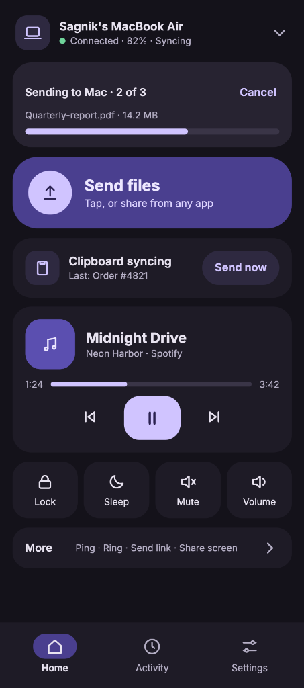
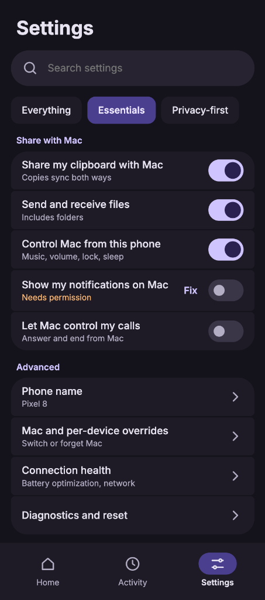

# Bridgey+

[](LICENSE)
[](#building--installing)
[](#security--privacy)

**Bridgey+** is an open-source, local-first continuity companion between **Android** and **macOS**—bringing automatic clipboard sync, multi-file & folder transfers, Mac media & remote controls, screen viewing, and a **Material 3 Expressive** Android experience over your local Wi-Fi network with no accounts, no cloud servers, and no telemetry.

> **Upstream attribution:** Bridgey+ is an independent community fork of [singeol/bridgey](https://github.com/singeol/bridgey) (MIT License). All original protocol and core architecture credit belongs to the upstream Bridgey project.

---

## Android App Preview

<p align="center">
  
  &nbsp;&nbsp;&nbsp;
  
</p>

### Frequency-First Material 3 Expressive UI
- **3-tab navigation (`Home · Activity · Settings`)** with a compact top Mac status strip showing connection status, Mac battery, and sync state.
- **Adaptive Home**: The top slot automatically surfaces what matters right now—live transfer progress, incoming links from your Mac, or a one-tap reconnect card when offline—while keeping your core controls in a fixed, muscle-memory order.
- **Ambient Clipboard**: Shows your last synced snippet with a quick **Send now** button and tap-to-pause toggle.
- **Adaptive Now Playing**: Appears automatically when Spotify or Apple Music is active on your Mac, with album art, seek bar, and a spring-animated shape-morphing Play/Pause control.
- **Searchable, Outcome-Based Settings**: Plain-language toggles, one-tap presets (**Everything**, **Essentials**, **Privacy-first**), and inline permission fixes right where you need them.

---

## Features

### Seamless Sync & Transfers
- **Automatic two-way clipboard sync**: Copy text or HTML on your MacBook and paste immediately on Android—no extra button press. On Android, copying while Bridgey+ is open (or switching to Bridgey+) auto-syncs to your Mac. Sensitive/concealed password-manager clips are automatically skipped, and echo loops are prevented.
- **Multi-file & folder transfers**: Pick or drag-and-drop multiple files or entire folders at once. Files transfer sequentially in a visible queue with per-file cancel, **Cancel all**, deterministic non-destructive naming, and batched Finder reveal on macOS.
- **Browse shared Android folders from Mac**: Explicitly share chosen Android folders via Storage Access Framework and browse/download files directly from a native macOS folder browser window.
- **Android Share-Sheet target**: Send files or web links to your Mac straight from any Android app.

### Remote Control & Continuity
- **Mac media controls**: Play/pause, skip tracks, seek, and adjust Spotify or Apple Music volume from your phone.
- **Quick Mac actions**: Lock screen, put Mac to sleep, turn off display, start screensaver, mute/adjust system volume, and launch allowlisted apps or macOS Shortcuts—available from Home, an Android Home-screen widget, and Android Device Controls.
- **Browser tab & link handoff**: Send your active Safari or Chrome tab from Mac to Android, or send links from Android to open on Mac.
- **View-only phone screen sharing** *(opt-in)*: Mirror your Android screen to a native macOS window with per-session consent on Android.
- **Notifications & Calls**: Mirror Android notifications (with inline replies & per-app filters) and view/control incoming phone calls from your Mac.
- **Ping, Find Device & Battery**: Check Mac/Android battery status, send a quick ping, or ring either device to locate it.
- **Multi-device sessions**: Stay connected to multiple paired devices simultaneously and switch your active target anytime.

---

## Security & Privacy

- **100% Local-First**: Devices discover each other over local Wi-Fi (`_bridgey._tcp.local.`) and communicate directly over TCP—no cloud relay, no accounts, no analytics.
- **End-to-End Encrypted**: Explicit two-device pairing with a 6-digit verification code, pinned peer signing identities (stored in macOS Keychain & Android Keystore), and application-layer **AES-GCM** encryption.
- **Privacy Safeguards**: Concealed/sensitive clipboard items are excluded from auto-sync, diagnostics exports strip all personal content, and you can wipe all local Bridgey+ data in one tap from Settings.

---

## Building & Installing

This repository is a monorepo with two native apps sharing a common protocol in [`protocol/`](protocol/):
- **macOS** ([`macos/`](macos/)): Native Swift / SwiftUI (Swift Package Manager)
- **Android** ([`android/`](android/)): Native Kotlin / Jetpack Compose (Gradle)

### macOS
Requirements: macOS 14+ with Xcode Command Line Tools (Swift 5.10+).

```bash
cd macos
./build-app.sh release
```

Install the generated app bundle:
```bash
rm -rf /Applications/Bridgey.app
cp -R .build/release/Bridgey.app /Applications/Bridgey.app
open /Applications/Bridgey.app
```

### Android
Requirements: Android SDK (`ANDROID_HOME` configured) and JDK 17.

```bash
cd android
./gradlew :app:testDebugUnitTest :app:assembleDebug
```

The APK is generated at:
```text
android/app/build/outputs/apk/debug/app-debug.apk
```

Install over USB:
```bash
adb install -r app/build/outputs/apk/debug/app-debug.apk
```

> **Note on Android 10+ background clipboard:** Android restricts background apps from reading the system clipboard. **Mac → Android** clipboard sync works completely automatically in the background; for **Android → Mac**, copying while Bridgey+ is open—or briefly switching to Bridgey+—auto-sends without tapping any button. You can also use the **Bridgey clipboard** Quick Settings tile or notification action.

---

## Documentation

- [Architecture Overview](docs/architecture.md)
- [Protocol Specification](docs/protocol.md)
- [Security Policy](SECURITY.md)

---

## License

MIT License — see [LICENSE](LICENSE) for details.  
Based on [singeol/bridgey](https://github.com/singeol/bridgey).
